<a href="https://erenkurular.com">
  
</a>

  
  
  

 

<picture>
  <source media="(prefers-color-scheme: dark)" srcset="assets/section-work-dark.svg" />
  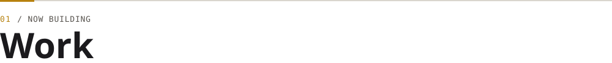
</picture>

<a href="https://store.steampowered.com/app/5331090/CozyDuck_Idle/">
  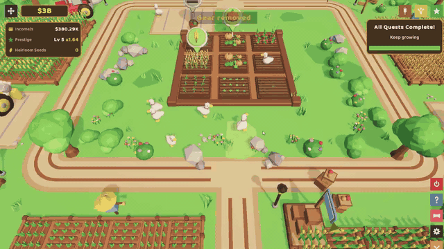
</a>

<a href="https://store.steampowered.com/app/5331090/CozyDuck_Idle/">
  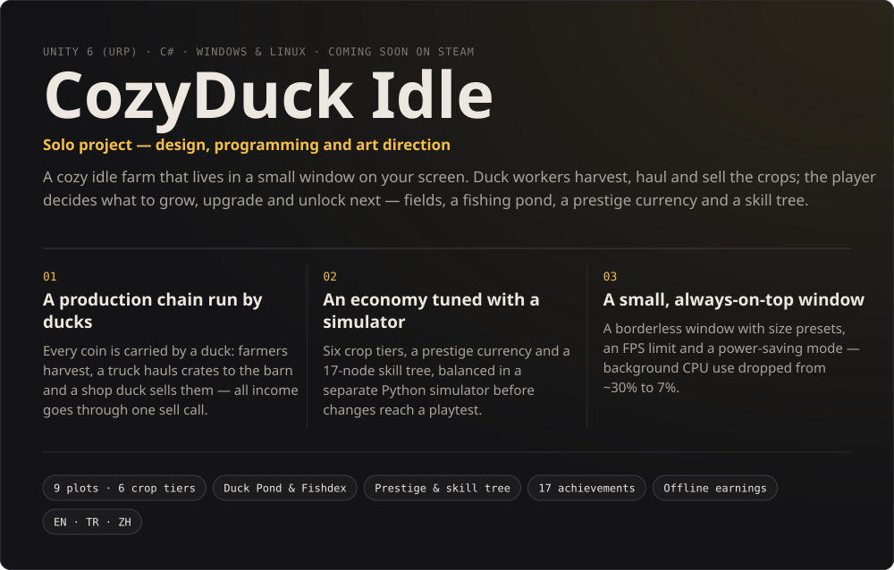
</a>

  

<picture>
  <source media="(prefers-color-scheme: dark)" srcset="assets/section-projects-dark.svg" />
  
</picture>

  <a href="https://www.youtube.com/watch?v=p9Ke7QdwrRc">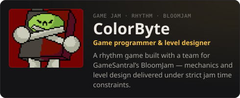</a>
  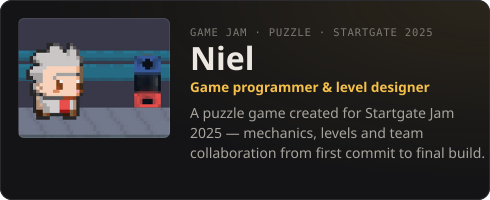
  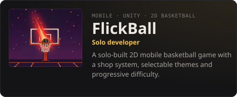
  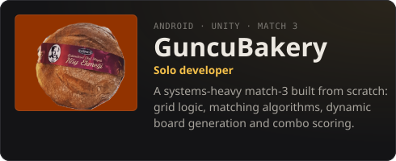
  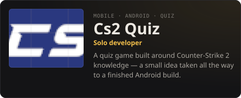
  <a href="https://wo1fff.itch.io">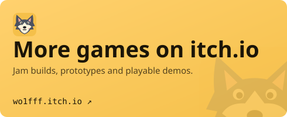</a>

 

<picture>
  <source media="(prefers-color-scheme: dark)" srcset="assets/section-about-dark.svg" />
  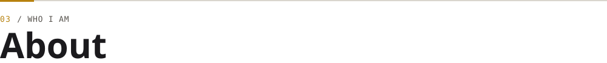
</picture>

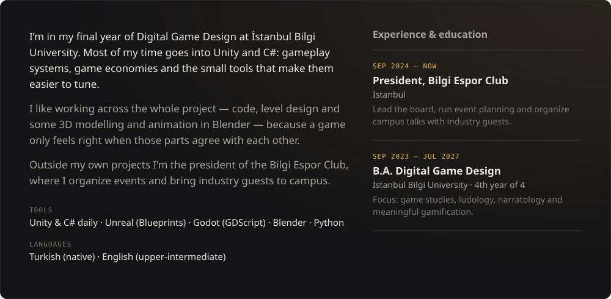

  
  
  
  
  
  
  

 

<picture>
  <source media="(prefers-color-scheme: dark)" srcset="assets/section-contact-dark.svg" />
  
</picture>

I’m looking for **game development roles, internships and collaborations**. Email is the fastest way to reach me.

  
  
  
  

 

<a href="https://erenkurular.com">
  <picture>
    <source media="(prefers-color-scheme: dark)" srcset="assets/footer-dark.svg" />
    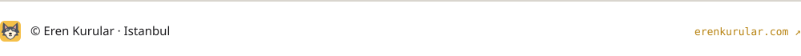
  </picture>
</a>
